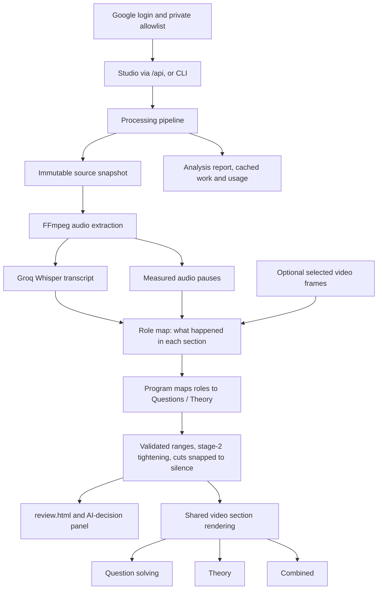

# Architecture and source layout

Lecture Trimmer performs one analysis per lecture and produces question-solving,
theory, and combined videos from that shared analysis.

## Source map

| Location | Responsibility |
| --- | --- |
| `lecture_trimmer/ui/` | Server entry point (`app.py`), the AI-decision review page, sign-in page and branding |
| `lecture_trimmer/processing/` | Pipeline orchestration, range planning, cancellation and job ownership |
| `lecture_trimmer/analysis/` | Teaching-activity roles, editor prompts, subject packs, validation and selected-frame evidence |
| `lecture_trimmer/media/` | Audio extraction, measured pauses, Groq speech recognition, precise video rendering and export validation |
| `lecture_trimmer/auth/` | Google identity, Sheet access checks, private file access and desktop OAuth |
| `lecture_trimmer/integrations/` | PW proxy requests, provider diagnostics and AI usage accounting |
| `lecture_trimmer/server/` | Persistent batch queue, assembly-line scheduler, the `/api` HTTP API and video-link downloads |
| `lecture_trimmer/web/dist/` | Built studio interface served at `/studio` (source in `frontend/`) |
| `lecture_trimmer/runtime/` | Private error reports, redaction and support exports |
| `lecture_trimmer/models.py` | Typed transcript, activity, classification and cut-range schemas |
| `lecture_trimmer/config.py` | Environment settings and processing defaults |
| `lecture_trimmer/paths.py` | Application source and asset locations |
| `lecture_trimmer/cli.py` | Command-line interface |
| `assets/` | Logo, browser favicon and Windows icons |
| `tests/` | Offline regression tests, including actual FFmpeg media checks |
| `tools/` | Release packaging and desktop installer tooling |
| `desktop_runtime/` | Desktop paths, signed updater and frozen dependency anchors |
| `vendor/` | Externally supplied PW access kit |
| `docs/` | Authentication, release and contributor guides |

## Data flow

The UI owns user interactions; the processing pipeline owns job stages. Media
modules own FFmpeg and transcription. Analysis modules own prompts, model calls
and semantic validation. Both UI and CLI call the same pipeline. Authentication
checks and exact file grants surround the private UI; they must not be bypassed
by adding a new route or background worker.

Cancellation flows through a per-job context into worker threads and FFmpeg.
Completed output and transcription chunks remain reusable. Provider requests
already in flight may finish after a stop request.

## Stable desktop boundary

The frozen host is deliberately separate from the replaceable application:

- `tools/desktop_launcher.py` is the EXE entry point; `desktop_runtime/` contains
  desktop paths, the updater and dependency anchors. Older installed executables
  contain the paths/updater under legacy names. The package reuses those exact
  instances to preserve their shared update locks and state.
- Root `app.py` and `main.py` are the only root Python files. They preserve the
  documented web and CLI commands. Application code imports `lecture_trimmer.*`.
- `tools/desktop_compat/` holds four adapters for older frozen hosts. The release
  builder places them at the payload root, where those EXEs expect them. Adapters
  share canonical application modules rather than duplicating state.
- `tools/start_groq.py` is the owner's personal launcher and is not included in
  shared application updates. `LectureTrimmer-Groq.cmd` launches it.
- `vendor/pw_access.py` is the externally supplied PW kit. Replace it at that
  location when updating the kit. The integration loads a separate kit
  instance for each login. Preserve its `Lecture_Trimmer` application name.

The build tool explicitly includes application modules, compatibility adapters,
the PW kit and assets. It excludes development data and private credentials.
Signed code updates retain runtime version `1`; changing frozen dependencies
requires a separately built and tested runtime installer.

## Data and credentials

Source runs load the root `.env`; packaged copies do not. Source data defaults
to the project directory. Desktop user data defaults to
`%LOCALAPPDATA%\LectureTrimmer`; `TRIMMER_DATA_DIR` can override the data location.
Moving source files must never move saved lectures, transcripts or outputs.

`temp/`, `output/`, `logs/`, `build/`, `dist/`, `releases/` and `.release-private/`
are generated or private directories, not application source. Do not include
them in source distributions or application payloads. Provider keys and signing
keys never belong in an installer.

## Editorial decisions

The model describes what observably happened (`ActivityRole`); `KIND_BY_ROLE` in
`models.py` decides the video. Changing where a role goes is a one-line program
change, not a prompt change, so it cannot make the category split drift between
versions. Stage-2 tightening cuts are checked by `_sanitize_tightening`: a cut
that breaks a clean-cut rule is dropped; stage-1 unrelated-passage validation
stays strict. Measured pauses (`media/pauses.py`) are cached per source and only
move cut points through silence.

## Current limits

Pause tightening uses audio only: with a teacher filmed in front of the board,
frame differences could not separate writing from movement, so silent board
work over 3 s (balanced) is shortened like any other pause.
Authentication sessions and file ownership are in memory; horizontal scaling
would require shared state. Speech-provider quotas still apply, and semantic
quality still needs evaluation on representative, human-reviewed lectures.
